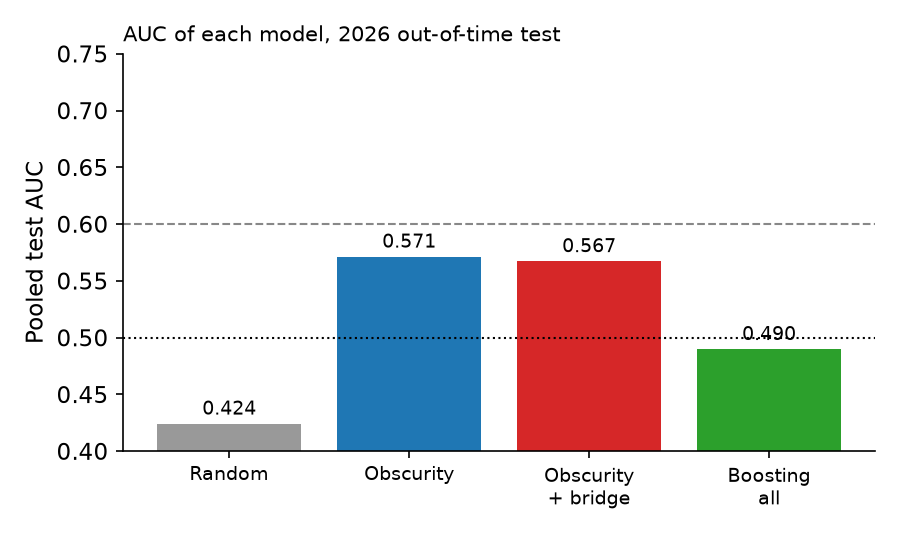

# Epoch summary: can we predict which open Erdős problems AI resolves? (2026-10-22)

Neither hypothesis held. Backtest: 7 monthly origins (2026-01 to 2026-07), 4,458 problem-origin rows, 152 events from about 68 problems, 3-month windows. [medium]

- H1 (obscurity + attention, AUC above 0.60): NO. AUC 0.571, 95% CI 0.511 to 0.632. [medium]
- H2 (bridge distance adds signal): NO. AUC 0.571 to 0.567, DeLong p 0.54, permutation p 0.61, clustered CI of change -0.024 to +0.015. [medium]
- Gradient boosting on all features: AUC 0.490, Brier 0.0340 (base-rate Brier 0.033). No ranking skill. [medium]
- Strongest groups when dropped: prior AI wiki attempts and status edits (each about -0.04 AUC for the logistic model). [low]
- Post hoc grouped CV (not out-of-time): bridge change -0.007, still null. [low]

Limits: only 4 training origins before the first test origin, wiki-derived labels, MiniLM embeddings. A null here limits this implementation, not the idea. Forecast of 593 open problems (about 7.8 expected AI resolutions in 3 months) is published with Brier scoring on 2027-01-22, 2027-04-22, 2027-10-22; its ranking has no demonstrated skill [low].

